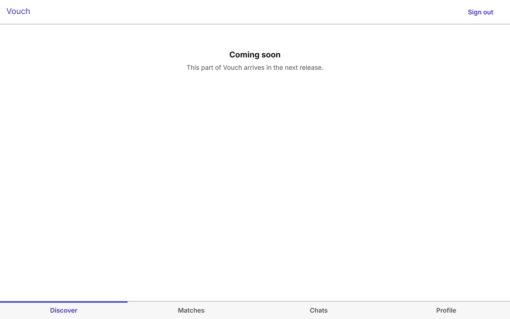
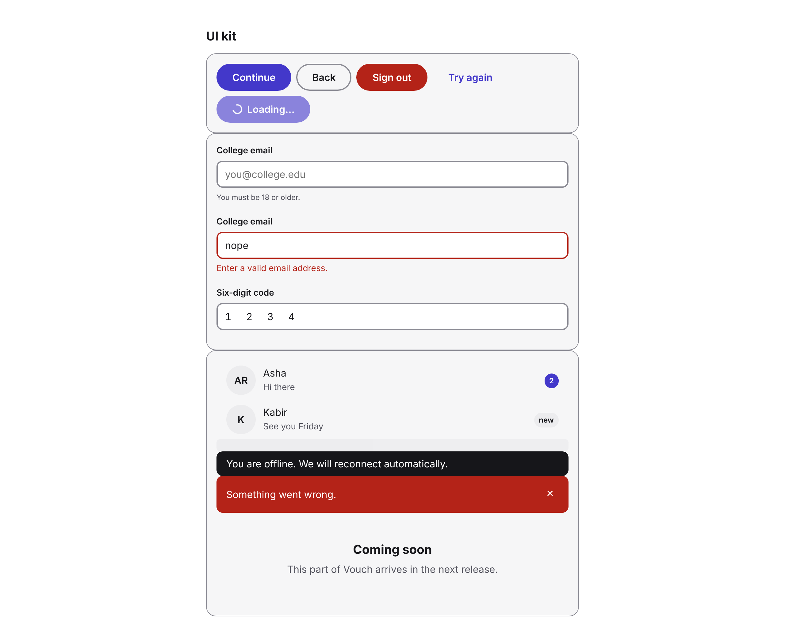
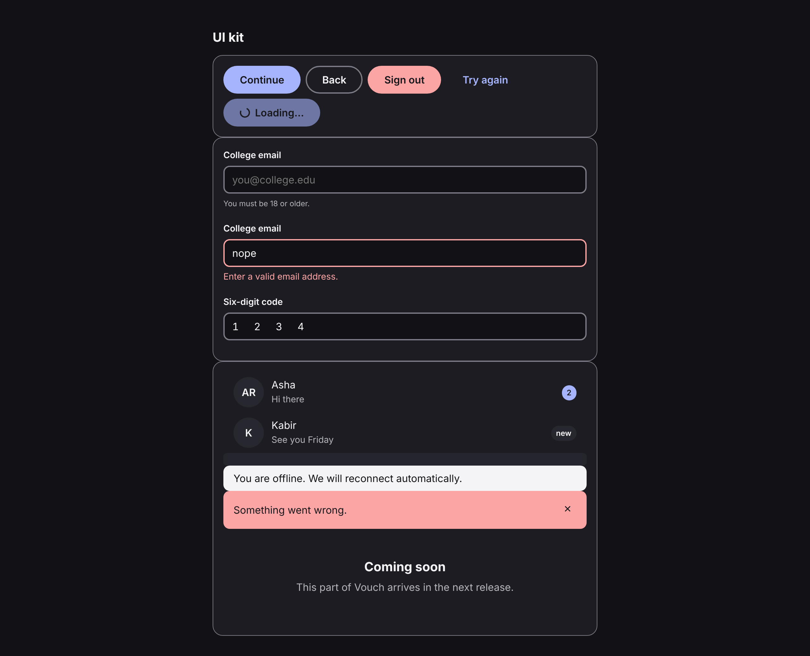

## Phase 11 — Frontend foundation: Start Plan

Written under the owner's batch authorisation for Phases 9–13 (see `docs/PROGRESS.md`,
"Batch run"); no separate approval is awaited.

**Status of prerequisites:**

- Phases 1–8 approved ✅.
- Phases 9 and 10 are complete and pending owner review, with CI green
  ([PHASE-09](PHASE-09.md), [PHASE-10](PHASE-10.md); run 68).
- The roadmap asks for Phase 10 to be approved so the API is stable. Under the batch
  authorisation the backend contracts are frozen as of Phase 10; later changes will be
  additive only.

**What I will build:**

1. **Tooling:**
   - JSX (`.jsx`) in the root typecheck (`tsc --checkJs`, `jsx: react-jsx`) and in ESLint
   - Feature-Sliced Design boundary rules for every app in dependency-cruiser: `app > pages >
widgets > features > entities > shared`, with no imports between slices of one layer and
     no imports between apps
   - a jsdom Vitest preset for UI tests
2. **`packages/i18n`:** English strings and a `t(key, params)` helper (missing keys fail in
   tests). Apps contain no hard-coded user-facing strings.
3. **`packages/domain`:** shared pure rules: age from date of birth (the same rule as identity),
   email and OTP validators, and formatting (relative time, counts).
4. **`packages/ui-tokens`:** colour (a neutral accessible palette, light and dark), spacing,
   type scale, radii and motion, as JS objects and CSS custom properties. Contrast is
   checked by a test (WCAG AA). The name is "Vouch"; the brand is a placeholder.
5. **`packages/api-client`:**
   - plain fetch functions generated from `packages/contracts` (`pnpm contracts:generate` also
     writes `packages/api-client/src/generated.js`), carrying metadata only, so no zod reaches
     the bundle
   - base URL, `X-App-Version`, automatic `Idempotency-Key` for header-idempotent endpoints, and
     the error envelope mapped to `ApiError`
   - single-flight refresh rotation (concurrent 401s trigger one refresh)
   - cookie transport on web and body transport on mobile
   - TanStack Query key factories
6. **`packages/realtime`:**
   - a socket.io-client wrapper: connect with the token, `auth.refresh` before expiry,
     exponential reconnect, and `sync` with stored cursors on every (re)connect
   - an outgoing queue that retries with the same `clientMsgId`
   - a TanStack Query cache adapter: `message.new` appends, `match.new` invalidates matches,
     and `config.changed` refetches config
7. **`packages/features-core`:**
   - `SessionProvider` / `useSession` (state machine: signed out → code sent → signed in)
   - `useConfig` / `useFlags` (`GET /v1/config`)
   - the feature registry (`defineClientFeature`, `featuresForSlot`, flag-filtered) and a React
     `<Slot name>`

   Platform-neutral and tested here (the owner's note: shared logic is tested in
   features-core).

8. **`packages/ui-web`:** Button, Input, OtpInput, Avatar, Card, Modal (Sheet), Toast,
   EmptyState, Skeleton, ListItem and Badge. They are accessible (labels, visible focus,
   44 px targets, `prefers-reduced-motion`), with component tests in jsdom.
9. **`packages/ui-native`:** the same components for React Native (type-checked, and bundled
   by the Expo build).
10. **`apps/web`** (React + Vite + React Router):
    - FSD folders, providers (QueryClient, session, config/flags, realtime)
    - the registry with the slots `home.tabs`, `profile.sections`, `profile.editor`,
      `chat.composerActions`, `chat.messageRenderers`, `deck.cardBadges` and `settings.rows`
    - an error boundary and a 404
    - sign-in: email → code → (first time: birth date + consent) → the home shell with tabs.
      An expired session goes back to sign-in.
11. **`apps/mobile`** (Expo SDK 58 + Expo Router):
    - the same structure, registry and slots
    - tokens in `expo-secure-store`, body transport
    - the splash screen
    - a forced-update screen from `minSupportedVersion`
    - the same sign-in flow
12. **`apps/admin`** (React + Vite): sign-in with email, password and TOTP (the admin token
    is kept in memory only), and the panel renderer skeleton (it lists the panels from
    `GET /v1/admin/panels`; Phase 13 renders them).
13. **`apps/landing/index.html`:** a static placeholder.
14. **`pnpm dev`:** runs the API and web together. The web dev server proxies `/v1` and
    `/socket.io` to the API.

**Out of scope:** discovery, matching, chat, profile and settings screens (Phases 12–13);
admin panels; web push.

**Dependencies** (pre-approved unless noted; exact versions, each at least two weeks old):

- React and React DOM 19.3.0, the same version Expo SDK 58 pins, so web and mobile share one
  React
- Vite 8.3.6, React Router 8.5.1, TanStack Query 5.107.1
- Expo SDK 58 and its recommended packages (`expo-router`, `expo-secure-store`,
  `expo-splash-screen`, `expo-constants`, `react-native`, `react-native-safe-area-context`,
  `react-native-screens`)
- `@playwright/test` 1.63.0 (matches the preinstalled browser), `@axe-core/playwright`,
  Testing Library
- **Also needed, justified in ADR 0021:** `@vitejs/plugin-react` (Vite's official React
  plugin), `jsdom` (the DOM for Testing Library), `@types/react` and `@types/react-dom`
  (type-checking)

**How I will verify it:**

- Unit tests:
  - the api-client error mapping and refresh single-flight (concurrent 401s → one refresh)
  - realtime reconnect and `sync` against a real Socket.IO test server
  - slots filtered by flags
  - i18n coverage and token contrast
- Component tests for the web UI kit, in light and dark themes.
- One Playwright test on web against the real API (Testcontainers): sign in with the OTP from
  the development email adapter and land on the home shell, with an axe scan (no serious
  violations).
- The web initial-JS budget (under 200 KB gzipped), checked by a script in CI.
- The FSD boundary lint in all apps.
- Mobile: no simulators here, so the app must type-check and bundle (`expo export` for
  Android and iOS). The report carries an "Owner manual checks" list.
- Then every check, a clean clone, repeated runs, mutation checks and CI.

**Branch:** `claude/lucid-rubin-foq2uj` (ADR 0002); one PR for Phases 9–13 at the end.

---

## Phase 11 — Frontend foundation: Completion Report

**Summary:** Web, mobile and staff-console shells now sit on shared packages:

- a generated API client
- a realtime client
- tokens, i18n and domain rules
- a feature registry with named slots
- two accessible UI kits

A student signs in on web against the real API, with the emailed code, and lands on the home
shell. This is covered by Playwright against the API in Testcontainers. The mobile app
type-checks and bundles for Android and iOS. Device runs are on the owner's manual-check
list.

**Completion criteria:**

- [x] **A user signs in on web and mobile against the local API and sees the home shell.**
  - **Web:** proven by `apps/web/e2e/sign-in.spec.js`. The real API runs in Testcontainers,
    the code comes from the development email adapter, and the test continues through first
    sign-up (birth date and consent) to the home tabs.
  - **Mobile:** the same flow (shared `createAuthFlow`, tested in `features-core`) is
    type-checked and bundled with `expo export` for Android and iOS (CI job `mobile`).
    Running it on a simulator or device is owner manual check 1, below; there are no
    simulators in this environment.
- [x] **The UI kit renders in light and dark themes.**
  - The `/ui-kit` page has an axe scan in both colour schemes, with no serious violations
    (`e2e`).
  - The WCAG AA contrast test covers every text/background pair in both themes (`ui-tokens`).
  - Screenshots are below.
- [x] **The slots render registered test features only when their flag is on.**
  - `features-core` tests check `itemsFor` and `<Slot>` with the flag on and off.
  - A mutation check (dropping the flag filter) is caught.

**What was built:**

- **Packages:**
  - `i18n`: `t()` and `createTranslator`; a missing key throws
  - `domain`: `ageOn`/`isAdult` (the backend's rule), `isIsoDate`, `isEmail`, `isOtp`,
    `relativeTime`, `formatCount` and `compareVersions`
  - `ui-tokens`: light and dark themes, space, radius, type scale, motion, a 44 px target and
    CSS variables
  - `api-client`: generated from the contracts by `pnpm contracts:generate`, with metadata
    only and no zod at runtime
    - `createApiClient`: `X-App-Version`, `Idempotency-Key`, `ApiError`, single-flight
      refresh
    - `createSession` (cookie or body transport) and `createSessionClient`
    - `keys`: `me`, `deck`, `matches`, `conversations`, `messages(id)` and `config`
  - `realtime`:
    - `createRealtime`: token via the auth callback, `auth.refresh` 60 s before expiry,
      backoff reconnect (also after server disconnects), `sync` with cursors on every
      connect, once-only delivery, and an outbox with a stable `clientMsgId`
    - `memoryCursors`
    - `queryCacheAdapter`: `message.new` appends; `match.new` and `conversation.closed`
      invalidate; `config.changed` refetches
  - `features-core`:
    - `SLOTS`, `defineClientFeature` and `createFeatureRegistry`
    - `createAuthFlow` and `errorKey`
    - `AppServicesProvider`, `useServices`, `useSession`, `useConfig`, `useFlags`, `<Slot>`
      and `useSlotItems`
  - `ui-web` / `ui-native`: the UI kit (list below). The web kit ships a generated
    `styles.css`; `Sheet` replaces `Modal` on native.
- **`apps/web`:**
  - **Layers:** `src/{app, pages, widgets, features, shared}`. `entities` arrives with the
    first entity in Phase 12; the rules already cover it.
  - **`app/`:** the providers (QueryClient, services, session, config and flags, realtime
    started on sign-in), `ErrorBoundary`, `SessionRestore` (a silent cookie refresh on load),
    `RequireSession` (an expired session goes back to sign-in), and the router.
  - **Pages and widgets:** sign-in (email → code → first-time birth date and consent), the
    home shell (`AppShell` with tabs from `home.tabs` and an offline banner from the socket
    status), a 404, and the lazy `/ui-kit` page.
  - **Dev servers:** the dev and preview servers proxy `/v1` and `/socket.io` to the API.
- **`apps/mobile`:**
  - Expo SDK 58 and RN 0.88 with Expo Router (`src/routes` re-exports pages)
  - the same layers, registry and slots
  - the refresh token in `expo-secure-store`; ids from `expo-crypto`
  - the splash screen held until the restore finishes
  - `UpdateGate`, which shows the forced-update page when the app is older than
    `minSupportedVersion`
  - the sign-in form, and tabs (Discover, Matches, Chats, Profile) from `home.tabs`
- **`apps/admin`:** sign-in with email, password and TOTP, with the token in memory only.
  `PanelsPage` lists `GET /v1/admin/panels`.
- **`apps/landing/index.html`:** a static placeholder.
- **Tooling:**
  - `tsconfig.web.json` and `apps/mobile/tsconfig.json` (JSX checked by `tsc --checkJs`)
  - the ESLint `frontend` preset
  - dependency-cruiser FSD rules for every app
  - jsdom Vitest setups
  - `apps/web/scripts/bundle-size.js`
  - the CI jobs `web` (build, size, Playwright and axe) and `mobile` (`expo export`)
  - `pnpm dev` runs the API and web together (turbo)

**UI kit component list:**

| Component  | Web (`ui-web`)                                                                  | Native (`ui-native`)                                  |
| ---------- | ------------------------------------------------------------------------------- | ----------------------------------------------------- |
| Button     | primary, secondary, danger and ghost; `loading` sets `aria-busy`; 44 px min     | `Pressable`, `accessibilityRole="button"`, busy state |
| Input      | label, hint and error tied with `aria-describedby`; `aria-invalid`              | label, hint and error, `accessibilityLabel`           |
| OtpInput   | one input with `one-time-code` autofill, digits only, shown as boxes            | one `TextInput` with `oneTimeCode` / `sms-otp`        |
| Avatar     | image with alt text, or initials with `role="img"`                              | image or initials, labelled                           |
| Card       | `div`, `section` or `article`                                                   | `View`                                                |
| Modal      | native `<dialog>` (focus moved in, Escape, inert background); a sheet on narrow | `Sheet` (RN `Modal`, slide-up, close button)          |
| Toast      | `status`, or `alert` for errors; dismiss button                                 | live region                                           |
| EmptyState | title, body and action                                                          | same                                                  |
| Skeleton   | `aria-hidden`; still under `prefers-reduced-motion`                             | same                                                  |
| ListItem   | a button only when clickable                                                    | `Pressable` only when clickable                       |
| Badge      | neutral, accent and danger, with an optional label                              | same                                                  |

**Screenshots** (Playwright, Chromium, real API):

- sign-in: 
- home shell after sign-in: 
- UI kit, light: 
- UI kit, dark: 

Mobile screenshots need a simulator or device (owner manual check 1).

**Bundle size:** the web initial JS is 126.8 KB gzipped, against a budget of 200 KB (the entry
chunk and its static imports; `/ui-kit` is lazy). The admin console is 83 KB gzipped. The
mobile Hermes bundles are about 2.8 MB each for Android and iOS (unminified export check).

**Package dependency graph** (workspace packages only; dependency-cruiser enforces that
packages never import apps and apps never import each other):

```
apps/web     ─┬─> features-core ─┬─> api-client ──(dev: contracts)
apps/mobile  ─┤                  └─> i18n
              ├─> realtime
              ├─> domain
              ├─> api-client
              ├─> i18n
              ├─> ui-web    (web)    ─┬─> ui-tokens
              └─> ui-native (mobile) ─┴─> i18n
apps/admin   ───> api-client, ui-web, i18n
```

**Tests and validation:**

Run on a clean clone of `3f37b92` (Node 24, pnpm 10.34.9). Every check ran unpiped under
`set -euo pipefail`, in this order:

- `pnpm install --frozen-lockfile`
- `lint`, `format:check`, `typecheck` (three projects) and `check:boundaries`
- `contracts:check`
- `test` and `test:invariants`
- the web `build`, `size` and `e2e`
- the admin `build`
- the mobile `export:check`

Everything passed.

| Package / suite                        | Tests              |
| -------------------------------------- | ------------------ |
| `i18n` / `domain` / `ui-tokens`        | 3 / 4 / 5          |
| `api-client`                           | 10                 |
| `realtime` (real Socket.IO server)     | 8                  |
| `features-core` (jsdom)                | 5                  |
| `ui-web` (jsdom) / `ui-native`         | 8 / 2              |
| `web` (jsdom) / `admin` / `mobile`     | 2 / 2 / 1          |
| **Frontend unit and component, total** | **50**             |
| `web` Playwright e2e (real API, axe)   | 5 passed (12–13 s) |
| Backend `api` (unchanged this phase)   | 421 in 51 files    |
| `contracts` / `config` (boundaries)    | 436 / 4            |
| Invariants                             | 7                  |

- **Repeated runs:** `realtime` 5 more times and the web e2e 2 more times on the clean clone,
  all green.
- **CI:** all four jobs (verify, web, mobile, docker) are green on
  [run 72](https://github.com/Tejas-lab-source/vouch/actions/runs/45054768708) (`8f02e9b`),
  and on the phase's final commit (linked in PROGRESS).
- **Run 70 failed** on the `styles.css` freshness test: the commit helper had run Prettier
  over the generated file. Fixed in `8f02e9b`, which tells Prettier to ignore the file.

**Mutation checks** (each change applied by a script that asserts the text is present, the
package's tests run, then the change is reverted; all 12 caught). Two survived on the first
run and got new tests: the dedupe of a repeated delivery, and the cursor never moving
backwards.

| #   | Mutation                                             | Caught by                    |
| --- | ---------------------------------------------------- | ---------------------------- |
| 1   | refresh no longer single-flight (`??=` → `=`)        | api-client: concurrent 401s  |
| 2   | no `Idempotency-Key` for header-idempotent endpoints | api-client                   |
| 3   | a failed refresh does not end the session            | api-client                   |
| 4   | a timed-out send is dropped from the outbox          | realtime: lost ack           |
| 5   | repeated `(conversation, seq)` delivered again       | realtime: new duplicate test |
| 6   | no `sync` on connect                                 | realtime: reconnect          |
| 7   | cursors may move backwards                           | realtime: new cursor test    |
| 8   | the slot flag filter removed                         | features-core                |
| 9   | unknown slot names accepted                          | features-core                |
| 10  | the age rule off by one year                         | domain                       |
| 11  | version comparison inverted                          | domain                       |
| 12  | a missing i18n key no longer throws                  | i18n                         |

**Decisions made:**

- [ADR 0021 — Frontend architecture: shared packages, Feature-Sliced apps and the slot registry](../adr/0021-frontend-architecture.md)

**Decisions taken without the owner** (under the batch authorisation):

1. **One React version (19.3.0) for web and mobile,** the version Expo SDK 58 pins, so the
   shared packages run unchanged on both.
2. **The generated client carries no zod at runtime.** It is plain fetch functions with JSDoc
   types inferred from the contracts. The server validates, and the bundle stays small.
3. **Web keeps the refresh token in the existing httpOnly, `SameSite=Strict` cookie,** and the
   access token in memory only. The dev and preview servers proxy the API under the same
   origin, so no CORS is opened.
4. **The staff console keeps its token in memory only.** A reload means signing in again.
5. **Mobile ids come from `expo-crypto`,** because Hermes has no `crypto.randomUUID`.
6. **The realtime client reconnects by itself after a server-initiated disconnect,** with
   jittered backoff (socket.io does not retry those). Deploy drains and expiry
   disconnects then recover.
7. **FSD is enforced with dependency-cruiser** (already the project's boundary tool) rather
   than an ESLint plugin. No new dependency was needed.
8. **Expo Router files live in `src/routes`,** a thin layer that only re-exports pages,
   so `src/app` stays the FSD app layer.
9. **The web UI kit ships a generated `styles.css`** (tokens plus component CSS) that Prettier
   ignores. A test fails if it is stale.
10. **Extra dependencies:** `@vitejs/plugin-react` 6.2.1, `jsdom` 31.0.0 and `@types/react`
    / `@types/react-dom` 19.3.0. pnpm overrides pin `@expo/cli` 58.1.19 and
    `@expo/router-server` 58.0.21, to resolve one `expo-constants`.
11. **Captcha is a seam.** `captchaToken()` returns the development token. Turnstile and its
    site key are wired in Phase 15, and production already refuses the development
    verifier.
12. **ESLint `no-unused-vars` is off for `.jsx` files.** ESLint without the React plugin
    does not see JSX usage. `tsc` (`noUnusedLocals`) enforces unused names instead.

**Deviations from the roadmap:**

- **Mobile was not run on Android or iOS simulators.** None exist in this environment. It
  type-checks and bundles for both platforms in CI, and the device checks are listed below
  for the owner.
- **FSD rules are in dependency-cruiser, not ESLint** (decision 7). They are enforced in CI
  either way.
- **No `entities/` folder yet:** there is no entity before Phase 12. The rules already
  include the layer.

**Known issues and risks:**

- **Mobile behaviour on devices is unverified here:** secure store, splash timing and the
  forced-update screen. It needs owner manual checks.
- **The mobile API URL is `extra.apiUrl` in `app.json`.** Per-build values come in Phase 15.
- **The cursors are in memory.** A cold start syncs from the server's conversation list,
  which arrives in Phase 13.

**Suggested follow-ups (not done, need approval):**

- Persist realtime cursors on mobile (AsyncStorage) to save a sync on cold start.
- A Storybook-like visual regression of the UI kit (screenshot diffs in CI).

**Owner manual checks (mobile):**

1. With Docker running, `docker compose up -d`, `pnpm db:migrate` and `pnpm db:seed`, then
   `pnpm dev` at the root, which starts the API (and web). In `apps/mobile`, set `extra.apiUrl` in
   `app.json` to your machine's LAN address, then `pnpm dev`. Open the app in an Android
   emulator and an iOS simulator (or Expo Go on a device). Sign in with a college email; the
   code is in the API log. Complete first sign-up (birth date and consent) and confirm the
   home tabs appear.
2. Kill and reopen the app: it restores the session from the secure store, with the splash
   screen held until it does, and skips sign-in.
3. Set `APP_MIN_SUPPORTED_VERSION` above the app version (`1.0.0`, in `app.json`) on the API and reopen: the
   forced-update screen appears.
4. Switch the device to dark mode: the UI uses the dark tokens. With a screen reader
   (TalkBack or VoiceOver), the buttons and fields are announced with their labels.

**How you can check it yourself:**

```bash
pnpm install && docker compose up -d && pnpm db:migrate && pnpm db:seed
```

```bash
pnpm dev   # API on :3000, web on :5173
```

Open http://localhost:5173, sign in with any `@northfield.example.edu` address (the code is in
the API log), and visit http://localhost:5173/ui-kit for the kit. To run the web end-to-end
tests yourself: `pnpm --filter @vouch/web e2e` (needs Docker).

**Pull request:** one PR for Phases 9–13 at the end of the batch · Branch:
`claude/lucid-rubin-foq2uj`
