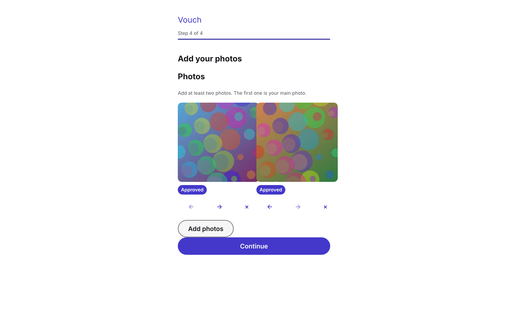
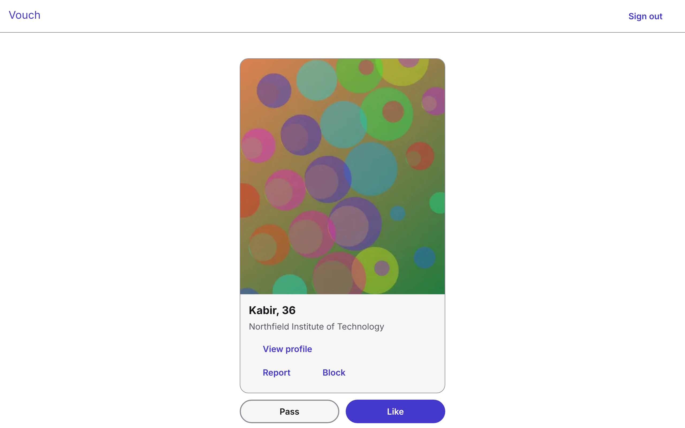
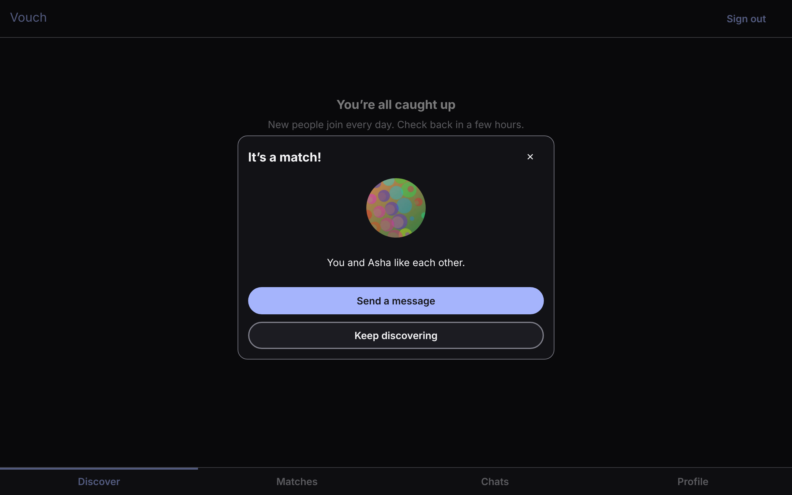
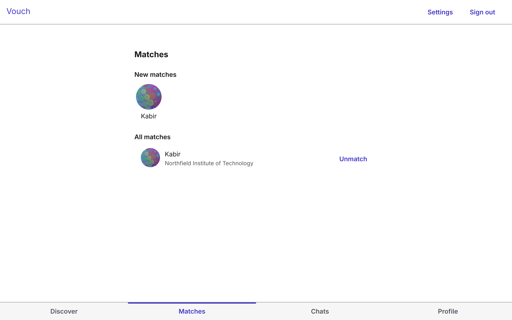

## Phase 12 — Frontend features I: onboarding, profile, discovery and matching: Start Plan

Written under the owner's batch authorisation for Phases 9–13 (see `docs/PROGRESS.md`,
"Batch run"); no separate approval is awaited.

**Status of prerequisites:**

- Phases 1–8 approved ✅
- Phases 9, 10 and 11 complete and pending owner review, with CI green ([PHASE-11](PHASE-11.md))

**What I will build:**

1. **Backend additions** (additive contract changes only, each with an integration test):
   - **`GET /v1/me/likes/count` → `{ count }`** (owner note). Matching's `likesIn` count of
     unanswered likes. It returns a number only, never who liked you.
   - **`PUT /v1/me/photos/order`** with `{ photoIds }` (owner note) returns `OwnProfile`.
     It must list exactly the caller's current photos. Positions are rewritten in one
     transaction, and an unknown or missing id is `VALIDATION_FAILED`.
   - **Storage CORS:**
     - Locally, `pnpm storage:init` applies a CORS rule to the SeaweedFS bucket: `PUT` from
       the web dev and preview origins, with only the signed headers.
     - The R2 rule (production origins only) is documented in the media README, for the owner
       to apply in Phase 15.
2. **`packages/features-core` hooks** (tested against a mock API):
   - **Profile:** `useMyProfile` and `useUpdateProfile`.
   - **Photos:**
     - `usePhotoUpload`: resize to at most 2048 px (a platform `prepareImage` port) →
       presign → `PUT` with progress → confirm → poll the profile until the photo leaves
       `pending`. A state machine with retry.
     - `useDeletePhoto` and `useReorderPhotos` (optimistic, rolled back on error).
   - **Deck and swipes:**
     - `useDeck`: fetches the next page when 3 cards remain, and drops duplicates.
     - `useSwipe`: removes the card optimistically, uses an idempotent `swipeId` (the same
       on retry), and puts the card back on error.
   - **Matches:** `useMatches` (an infinite query), `useUnmatch` and `useLikesCount`.
   - **Safety:** `useReport` and `useBlock`.
   - **Onboarding:** `useOnboarding`. The next step comes from the server profile
     (`missing`, photos) plus a local step marker. Only the step id is stored locally, never
     personal data, so progress survives a restart.
   - **Analytics:** an `Analytics` port, with a logging adapter in v1.
3. **Onboarding (web and mobile):**
   - **Order:** email → code → date of birth plus notice and consent (the API requires both
     to create the account, so consent comes before any data is stored; under 18 is blocked
     with a clear message) → name and gender → interested in → age range → photos → done.
   - **Photos:** at least 2, with per-photo status (pending, approved or rejected), delete,
     and reorder with accessible move buttons.
4. **Profile:**
   - view the own profile and edit its fields
   - manage photos, as in onboarding
   - the `profile.sections` and `profile.editor` slots (empty in v1)
5. **Discover:**
   - **Deck widget:**
     - Web: Like and Pass buttons, plus keyboard ←/→.
     - Mobile: swipe gestures (`PanResponder` and `Animated` with the native driver; no new
       dependency).
   - **Profile card:** a 400 px photo with details. The detail view uses 1080 px photos.
   - **Card extras:** the `deck.cardBadges` slot, and Report and Block actions on the card
     (Phase 10 APIs; a block removes the card).
   - **Empty deck:** "You're all caught up" with a time hint.
6. **Match moment:** on `{ matched: true }` or a `match.new` socket event, a match dialog
   offers "Send a message". It goes to the chat route, a placeholder until Phase 13.
7. **Matches:** a row of new matches (no conversation yet) and the list (infinite), the likes
   count, and unmatch with a confirmation step.
8. **Analytics:** onboarding steps completed, deck viewed, swipe and match, through the
   logging adapter. The event list goes in `docs/analytics.md`. Events carry no personal
   data.
9. **Images:**
   - **Web:** ``, with explicit sizes and the browser cache.
   - **Mobile:** `expo-image` (memory and disk cache).
   - **Resizing:** canvas on the web, `expo-image-manipulator` on mobile. Images are
     re-encoded as JPEG at most 2048 px on the long edge, and the re-encode strips EXIF
     (including location).
10. **Real photo sizes** (owner note): measure the 400 and 1080 variant sizes on real
    photographs through the real pipeline, and record them in the report.

**Out of scope:** chat screens, notification permission prompts, settings and the safety
centre (Phase 13); admin panels (Phase 13).

**Dependencies** (Expo-recommended, pre-approved): `expo-image`, `expo-image-picker` and
`expo-image-manipulator` (SDK 58 versions). Nothing new on the web.

**How I will verify it:**

- **Hook tests (mock API):**
  - the optimistic swipe rollback, and the same `swipeId` on retry
  - the photo upload state machine (progress, confirm, poll, failure and retry)
  - the deck prefetch at 3 remaining
  - the onboarding step derivation and its restore after a restart
  - reorder rollback
- **Backend:** integration tests for the likes count and the reorder: ownership, an exact
  set, and the count never revealing identities.
- **Playwright (web), two browser contexts against the real stack** (Postgres, Redis and
  SeaweedFS in Testcontainers; development moderation):
  - both users onboard with 2 real JPEG photos, uploaded from the browser through CORS
  - each sees the other in the deck, both like, and both see the match
  - also covered: under-18 blocked, unmatch, and axe on each new page in light and dark
- **Mobile:** type-check and `expo export`, plus an owner manual checklist (60 fps swipes on
  a mid-range Android device, the photo picker, the camera roll permission).
- **Then:** every check, a clean clone, repeated runs, mutation checks and CI.

**Branch:** `claude/lucid-rubin-foq2uj` (ADR 0002); one PR for Phases 9–13 at the end.

---

## Phase 12 — Frontend features I: onboarding, profile, discovery and matching: Completion Report

**Summary:** On the web, against the real API, two new students now:

- onboard, uploading real photos from the browser through the bucket's CORS rule
- see each other in their decks, like each other, and both get the match moment
- find each other in their matches, then unmatch

Playwright runs this with two browser contexts. Mobile has the same screens over the same
hooks; it type-checks and bundles for Android and iOS, and the device checks are listed below
for the owner. The owner's notes are done:

- the likes count
- photo reordering
- client resizing to 2048 px
- the CORS rule
- real-photo variant sizes

**Completion criteria:**

- [x] **Two new users onboard, see each other in their decks, like each other, and both see
      the match.**
  - **Web:** `apps/web/e2e/match.spec.js`.
    - Asha (light) and Kabir (dark) sign up and onboard, uploading two JPEGs each from the
      browser: resize → presign → `PUT` to SeaweedFS (CORS) → confirm → approved.
    - Asha sees Kabir's card (400 px photo), checks the details (1080 px photos) and likes
      with →.
    - Kabir likes back with the button. Kabir sees the match dialog from the swipe answer;
      Asha sees it live over the socket (`match.new`) and goes on to the chat placeholder.
    - Both match lists show the other person. Kabir unmatches with confirmation, and both
      lists empty.
  - **Mobile:** the same hooks; device run is owner manual check 1.
- [x] **Under 18 is blocked at onboarding:** the `match.spec.js` under-18 test shows the alert
      "You must be 18 or older to use Vouch." The server refuses with `UNDERAGE`, and no
      account is created.
- [x] **The Playwright suite is green:** 7 tests (output below), locally and in CI.

**Owner notes, as implemented:**

| Note                                       | Where and test                                                                                                      |
| ------------------------------------------ | ------------------------------------------------------------------------------------------------------------------- |
| Likes count `GET /v1/me/likes/count`       | matching `getLikesCount`; integration test (own count only, 401 when signed out); shown on the matches screen       |
| Photo reordering                           | `PUT /v1/me/photos/order` (exact set, one transaction); unit and integration tests; "earlier/later" buttons; e2e    |
| Client resize to 2048 px                   | `fitWithin` + web canvas / mobile `expo-image-manipulator`; JPEG re-encode drops EXIF; unit test                    |
| R2 CORS rule (documented, applied locally) | `uploadCorsRule`; `pnpm storage:init`; integration test of the preflight; e2e uploads; R2 steps in the media README |
| Variant sizes on real photos               | `scripts/measure-variants.js`; results below                                                                        |

**What was built:**

- **API (additive contracts):**
  - `reorderMyPhotos` and `getLikesCount`, with generated client functions
  - the storage adapter's `applyUploadCors`, used by `storage:init`
- **`packages/features-core`:** the hooks in the start plan (README), with the `PhotoIo`,
  `Prefs`, `Analytics`, `EventHub` and `newId` ports.
- **Web:**
  - **Entities:** `profile-card`.
  - **Features:** `profile-fields`, `photo-manager`, `card-safety` (report and block),
    `unmatch` and `match-moment`.
  - **Widgets:** `deck`.
  - **Pages:** onboarding, discover, matches, profile and the chat placeholder.
  - **Routing:** `RequireOnboarded` gates the shell; the four tabs are registered as features.
- **Mobile:** the same slices, with `PanResponder` swipes, the Expo image picker,
  manipulator and image, `FlatList` matches, and the secure-store prefs.
- **Docs:** ADR 0022, `docs/analytics.md`, the media, profiles and matching READMEs, the
  features-core, web and mobile READMEs, and the CHANGELOG.

**Screenshots** (Playwright, real API and storage):

- photos step: 
- deck: 
- match moment (dark): 
- matches: 

A screen recording isn't possible here; the screenshots and the Playwright steps stand in for
it.

**Playwright output** (local, `pnpm --filter @vouch/web e2e`):

```
Running 7 tests using 1 worker
  ✓  1 e2e/match.spec.js › two new students onboard with photos, see each other, like each other, and both see the match (14.3s)
  ✓  2 e2e/match.spec.js › an under-18 birth date is refused at sign-up with a clear message (430ms)
  ✓  3 e2e/sign-in.spec.js › a new student signs in with the emailed code and lands in onboarding (1.0s)
  ✓  4 e2e/sign-in.spec.js › a wrong code is refused with a readable message (315ms)
  ✓  5 e2e/sign-in.spec.js › the UI kit has no serious accessibility violations in the light theme (1.6s)
  ✓  6 e2e/sign-in.spec.js › the UI kit has no serious accessibility violations in the dark theme (1.6s)
  ✓  7 e2e/sign-in.spec.js › an unknown page shows the 404 (123ms)
  7 passed (29.5s)
```

**Axe results:** no serious or critical violations on any page tested:

- onboarding "About you" and the photos step (light and dark, one per user)
- the deck
- the match dialog (dark)
- the matches pages of both users
- the profile page (dark)
- the UI kit (light and dark)

**Variant sizes on real photographs** (`node scripts/measure-variants.js`, production sharp
settings, WebP quality 80). The photographs are scikit-image's sample photos: no other real
photos are reachable from this sandbox (Wikimedia is blocked by the network policy).

| Photo                | Source        | 400 px variant  | 1080 px variant\* | Time   |
| -------------------- | ------------- | --------------- | ----------------- | ------ |
| astronaut (portrait) | 512×512 PNG   | 400×400 21.6 KB | 512×512 31.0 KB   | 75 ms  |
| chelsea (cat)        | 451×300 PNG   | 400×266 13.4 KB | 451×300 16.6 KB   | 48 ms  |
| coffee               | 600×400 PNG   | 400×267 18.7 KB | 600×400 37.1 KB   | 54 ms  |
| grass (high detail)  | 512×512 PNG   | 400×400 56.0 KB | 512×512 92.3 KB   | 78 ms  |
| motorcycle           | 741×500 PNG   | 400×270 23.6 KB | 741×500 59.4 KB   | 87 ms  |
| hubble deep field    | 1000×872 JPEG | 400×349 21.2 KB | 1000×872 131.6 KB | 167 ms |
| rocket               | 640×427 JPEG  | 400×267 10.5 KB | 640×427 25.3 KB   | 64 ms  |

\* Never upscaled, so for these small sources the "1080" variant is the source size.

- **400 px variants:** real photos give 10–56 KB, against 0.5 KB for Phase 6's synthetic
  images. A deck page of 10 cards is about 0.2–0.6 MB.
- **1080 px variants:** expect about 100–250 KB for phone photos, extrapolating from the
  1000 px Hubble image. Owner manual check 5 confirms this on real phone photos.

**API friction found:**

- **Two additive endpoints**, both from owner notes: `PUT /v1/me/photos/order` and
  `GET /v1/me/likes/count`.
- **No breaking change:** `contracts:diff` against main passes.
- **Generated response types are `any`** across packages, so `features-core` declares the
  screen shapes (decision 9). A typed contract helper is a follow-up.
- **No "unread/new" signal on matches** yet: the "New" row uses the last 3 days (decision 8).

**Tests and validation:**

Run on a clean clone of `cb17011` (Node 24, pnpm 10.34.9), with every check unpiped under
`set -euo pipefail`:

- install, lint, format, typecheck (three projects), boundaries and `contracts:check`
- `test` and `test:invariants`
- the web build, size and e2e
- the admin build
- the mobile `export:check`

| Suite                                                 | Tests                               |
| ----------------------------------------------------- | ----------------------------------- |
| `features-core` (incl. 20 Phase 12 hook tests)        | 25 (5 + 20)                         |
| other frontend packages and apps                      | 45                                  |
| Backend `api` (incl. reorder, likes count and CORS)   | 424 in 51 files (was 421)           |
| `contracts` / `config`                                | 444 / 4                             |
| Invariants                                            | 7                                   |
| Web Playwright (real API, Postgres, Redis, SeaweedFS) | 7 (3 runs, all green)               |
| Web initial JS                                        | 137.5 KB gzipped (budget 200 KB)    |
| Mobile bundles                                        | Android 2.9 MB, iOS 3.0 MB (Hermes) |

**Two failures found on the way, both fixed:**

- **CI runs 75–78:** `api-client` had a hard-coded endpoint count (45). It now compares the
  generated functions with the contract endpoints by id. My commit helper ran only the
  contracts tests, so it also runs every non-API package test now.
- **The first clean-clone run:** the Phase 10 test "an invalid token is removed" read the
  delivery row before the worker recorded it (the token is removed first). The test now waits
  for the final status; 3 runs are green.

**One timing miss on a loaded host:** in one clean-clone run, right after the full suite, the
Phase 9 load smoke measured p95 1,101 ms against its 1 s target. Re-run alone it passed
(p95 516 ms, 0 lost, 0 duplicates), and CI passes it. Listed under known issues.

**CI:**
[run 81](https://github.com/Tejas-lab-source/vouch/actions/runs/45059689511) (`cb17011`) is
green on all four jobs; the report commit is linked in PROGRESS.

**Mutation checks** (each change applied by script, the tests run, then the change reverted;
all 14 caught). The reorder rollback survived at first; its test now observes the optimistic
order and then the rollback.

| #   | Mutation                                             | Caught by                                 |
| --- | ---------------------------------------------------- | ----------------------------------------- |
| 1   | reorder: the exact-count check removed               | profiles unit test                        |
| 2   | reorder: ids not checked against the caller's photos | profiles unit test                        |
| 3   | CORS rule also allows `DELETE`                       | photos integration (preflight)            |
| 4   | likes count off by one (not the caller's own count)  | matching integration                      |
| 5   | deck re-adds swiped cards                            | features-core (prefetch test)             |
| 6   | prefetch at 2 instead of 3                           | features-core                             |
| 7   | a refused card (`NOT_SERVED`) is put back            | features-core                             |
| 8   | no rollback after a failed swipe                     | features-core                             |
| 9   | a new `swipeId` on retry                             | features-core (same id across 3 attempts) |
| 10  | upload resume presigns again                         | features-core (presign count)             |
| 11  | resize upscales small images                         | features-core (`fitWithin`)               |
| 12  | reorder: no rollback on error                        | features-core (strengthened test)         |
| 13  | onboarding skips the age-range step                  | features-core                             |
| 14  | analytics allow-list removed                         | features-core (`sanitizeProps`)           |

**Decisions made:**

- [ADR 0022 — Client features: onboarding, photos, deck and matches](../adr/0022-client-features-onboarding-photos-deck.md)

**Decisions taken without the owner** (under the batch authorisation):

1. **Consent comes before onboarding.** The API needs the birth date and consent to create the
   account, so they come right after the code, and the roadmap's "notice and consent" step
   moves to the start. Nothing is stored before consent.
2. **Onboarding position:** derived from the server profile, plus the confirmed step names on
   the device (localStorage / secure store), keyed by the pseudonymous public id. No personal
   data is stored locally.
3. **Onboarding can finish with 2 photos that are not rejected.** The profile goes live when
   2 are approved, and the done screen says so. Waiting for moderation would block users when
   photos are held for review.
4. **Reorder takes the exact set of current photos** (`PUT`, idempotent). A partial or stale
   list is `VALIDATION_FAILED`.
5. **Reorder uses "move earlier/later" buttons**, not drag-and-drop: keyboard and
   screen-reader operable, and no new dependency.
6. **Mobile swipes use React Native's own `PanResponder` and `Animated`** (JS driver), not a
   gesture or animation library. 60 fps is an owner device check; if it falls short,
   `react-native-gesture-handler` + Reanimated (pre-approved) is the fix.
7. **Each match is shown once.** The swiper gets both the swipe answer and `match.new`; the
   match moment de-duplicates by match id, and analytics count it once.
8. **The "New" matches row shows matches from the last 3 days.** Phase 13 can switch it to
   "no messages yet" once the conversation list is on screen.
9. **`features-core` declares explicit client types** for the profile, card and match
   shapes, because the generated types resolve to `any` across workspace packages.
10. **The likes count may include a pass from the last few seconds** (still in the Redis
    buffer) until it is written. This is documented in the contract.
11. **The bucket CORS rule allows `PUT` with `content-type` only, from `CORS_ORIGINS`.** The
    browser sets `content-length` itself, so the client skips it.
12. **The e2e users are 36 and look for ages 30–40,** which keeps the 2,000 seeded synthetic
    users (18–25) out of their decks without changing the seed.
13. **Real-photo sizes were measured on scikit-image's sample photographs**, because the
    network policy blocks other sources. A script is provided for the owner's own photos.
14. **New Expo packages:** `expo-image` 58.0.18, `expo-image-picker` 58.0.10 and
    `expo-image-manipulator` 58.0.16. The picker has no camera or microphone permission.

**Deviations from the roadmap:**

- **Consent order** (decision 1).
- **The mobile simulator checklist is not run here;** there are no simulators. Owner manual
  checks below.
- **No recording of the two-user flow.** Screenshots and the Playwright transcript replace it.

**Known issues and risks:**

- **Mobile drag smoothness on low-end Android is unverified** (decision 6).
- **Web images are browser-cached only.** A CDN cache policy for `photos/` is Phase 15.
- **The 1080 px variant size on real phone photos is extrapolated** (owner check 5).
- **The "New" matches row is time-based** (decision 8).
- **The Phase 9 load-smoke p95 is close to its 1 s target on a loaded machine** (1,101 ms once
  locally, 516 ms alone). Phase 14 should give it a dedicated runner or a margin.

**Suggested follow-ups (not done, need approval):**

- A typed `defineEndpoint` (generic JSDoc), so generated client types flow to the apps without
  hand-written shapes.
- Drag-and-drop photo reordering as an extra on top of the buttons.

**Owner manual checks (mobile):**

1. With the stack running (`docker compose up -d`, `pnpm db:migrate`, `pnpm db:seed`,
   `pnpm storage:init`, `pnpm dev`), set `extra.apiUrl` in `apps/mobile/app.json` to your
   machine's LAN address, then run `pnpm --filter @vouch/mobile dev` on an Android emulator and
   an iOS simulator. Sign up two students and complete onboarding, including two photos from
   the library: progress shows, then "Approved". Like each other: both see "It's a match!".
   Both see each other under Matches.
2. Kill the app during onboarding (after the age step) and reopen: it resumes at the photos
   step.
3. On a mid-range Android device, drag cards in the deck: the motion should feel smooth
   (60 fps; use "Profile GPU rendering" if unsure). Release past about a third of the screen
   width to like or pass, otherwise the card springs back.
4. With TalkBack or VoiceOver, the deck card offers "Like" and "Pass" actions, and the photo
   buttons read "Move photo 2 earlier" etc.
5. Run `node apps/api/scripts/measure-variants.js ~/path/to/phone-photos/*.jpg` on a few of
   your own phone photos and note the 1080 px variant sizes.
6. The first photo pick asks for photo-library access with "Vouch uses the photos you choose
   for your profile."; the camera is never requested.

**How you can check it yourself:**

```bash
docker compose up -d && pnpm db:migrate && pnpm db:seed && pnpm storage:init
```

```bash
pnpm dev
```

Open http://localhost:5173 in two browser windows (one private), and sign up two students at
`@northfield.example.edu` with birth dates around 1990 and an age range of 30–40. Upload two
photos each, then like each other. The end-to-end run: `pnpm --filter @vouch/web e2e`.

**Pull request:** one PR for Phases 9–13 at the end of the batch · Branch:
`claude/lucid-rubin-foq2uj`
