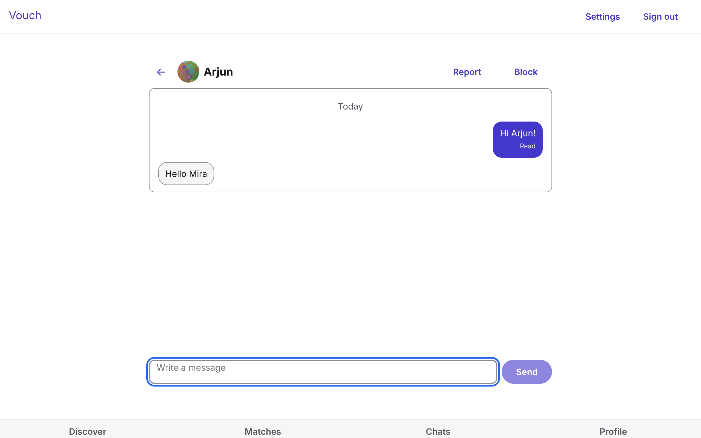
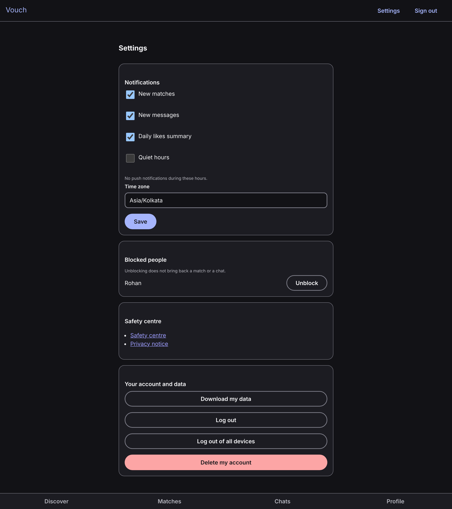
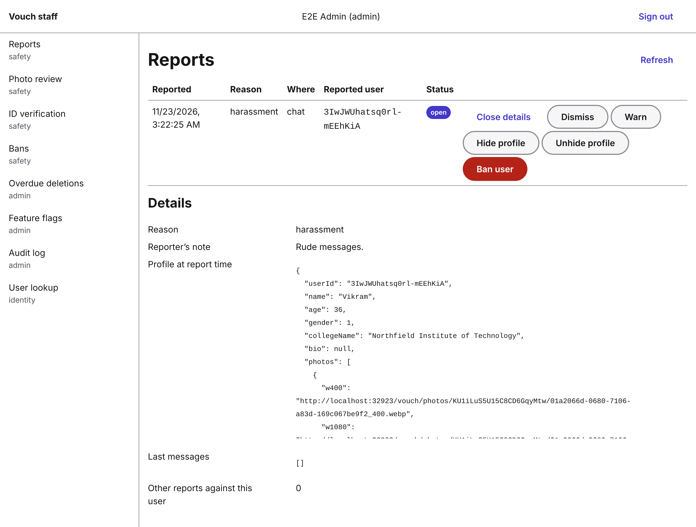
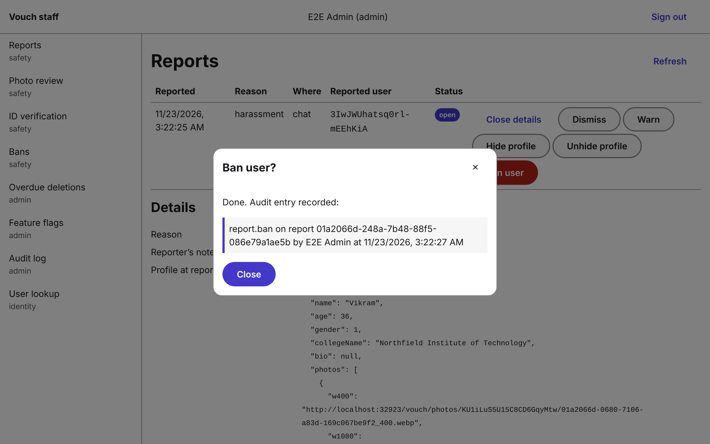

## Phase 13 — Frontend features II: chat, notifications, safety, settings and admin app: Start Plan

Written under the owner's batch authorisation for Phases 9–13 (see `docs/PROGRESS.md`,
"Batch run"); no separate approval is awaited.

**Status of prerequisites:**

- Phases 1–8 approved ✅
- Phases 9–12 complete and pending owner review, with CI green ([PHASE-12](PHASE-12.md))

**What I will build:**

1. **Backend additions** (additive contract changes only, each with an integration test):
   - **Read and delivery receipts for the sender:**
     - a new server event, `receipt.updated` `{ conversationId, deliveredSeq, readSeq }`, sent
       to the other member when a cursor moves forward
     - the other member's cursors (`peerDeliveredSeq`, `peerReadSeq`, optional fields) on the
       `listMessages` response

     These carry cursors only, never content.

   - **`GET /v1/me/notification-prefs`:** settings must show the current values (today the
     preferences are only writable).
   - **`GET /v1/me/blocks` and `DELETE /v1/blocks/{userId}`** (owner note): list the people you
     blocked and unblock one. Unblocking never restores a match or a conversation.
2. **`features-core` hooks** (tested against a mock API and a fake socket):
   - **Chat:**
     - `useConversations`
     - `useMessages(conversationId)`: an infinite query backwards, plus live appends from
       realtime, deduplicated by seq
     - `useSendMessage`: a message state machine, `sending` → `sent` (ack with seq) →
       `delivered` → `read`, with `failed` and retry keeping the same `clientMsgId`
     - `useMarkRead` and `useReceipts`
   - **Notifications:** `useNotificationPrefs` and `useUpdateNotificationPrefs`, plus a push
     port (permission, token, registration through `POST /v1/devices`).
   - **Settings and safety:** blocked users (list and unblock), data export, delete account,
     log out, and log out of all devices (revoke every other device, then log out).
3. **Chat UI (web and mobile):**
   - **Conversation list:** last message and unread count.
   - **Conversation screen:**
     - a virtualised list (web: `@tanstack/react-virtual`, the one pre-approved list
       library; mobile: `FlatList`)
     - date separators and per-message states
     - the composer with the `chat.composerActions` slot, and messages rendered through
       `chat.messageRenderers` by `kind`
     - the closed state, and report or block from the header
4. **Offline and resume (mobile):** the last 50 messages per conversation are kept on the
   device (`@react-native-async-storage/async-storage`, Expo-recommended) and cleared at sign
   out. Resume runs `sync`; queued sends go out after reconnect.
5. **Push (mobile):**
   - **Permission:** asked after the first match, not at install (`expo-notifications`).
   - **Registration:** the token goes through `POST /v1/devices`.
   - **Taps:** a tap deep-links to the conversation or the matches tab.
   - **Clearing:** opening a conversation clears its notifications.
   - Web push stays out of scope: it would need a service worker and VAPID keys, so it is a
     follow-up.
6. **Settings (web and mobile):**
   - notification preferences and quiet hours (with time zone)
   - the blocked-users list
   - a safety centre page (tips and how to report)
   - data export (download as JSON)
   - delete account, with confirmation and the 30-day cooling-off explanation
   - log out, and log out of all devices
   - the privacy notice and grievance contact
   - the `settings.rows` slot
7. **Admin app:**
   - **Panels:** rendered generically from the `GET /v1/admin/panels` definitions (list
     columns, detail fields and actions, with notes and confirmation where the definition
     says so).
   - **Panel list:** the reports queue with evidence and actions, photo review, verification
     reviews, user lookup and bans, the flags editor, the audit log, and overdue deletions.
   - **Every action** asks for confirmation and then shows the audit entry it created.
   - **Access:** routes are unreachable without an admin session.
8. **Phase 12 follow-up:** the "New" matches row becomes "matches with no messages yet", now
   that the conversation list is on screen.

**Out of scope:** typing indicators, media messages, premium, deployment, and web push (above).

**Dependencies** (pre-approved, exact versions at least two weeks old):

- `@tanstack/react-virtual` (web list virtualisation)
- `expo-notifications`, `expo-device` and `@react-native-async-storage/async-storage` (Expo SDK 58
  versions)

**How I will verify it:**

- **Hook tests:**
  - the message state machine, through every state and failure
  - dedupe on replay (live and `sync`)
  - a queued send after reconnect, with the same `clientMsgId`
  - receipts advancing the states
  - prefs round trip
- **Backend integration tests** for receipts (cursors only, members only), prefs `GET`, and
  blocks list and unblock (own blocks only; no match comes back).
- **Playwright (web, real stack):**
  - two users chat in real time
  - one goes offline (the browser context goes offline), gets the messages on return, in
    order and without duplicates
  - read receipts show
  - a block closes the chat for both
  - an admin signs in (password + TOTP), works the report and bans the user, and the banned
    user is signed out
  - axe on the chat, settings and admin pages
- **The message list with 1,000 messages:** only a window of rows is in the DOM, and scrolling
  stays responsive (a measured test).
- **Mobile:** type-check and `expo export`, plus an owner manual checklist (push in the
  background, tap opens the right conversation, the denied-permission path, offline resume).
- **Then:** every check, a clean clone, repeated runs, mutation checks and CI.

**Branch:** `claude/lucid-rubin-foq2uj` (ADR 0002); one PR for Phases 9–13 at the end.

---

## Phase 13 — Frontend features II: chat, notifications, safety, settings and admin app: Completion Report

**Summary:** Every v1 feature is now usable end to end on the web against the real stack:

- sign-up and onboarding
- the deck, matching and chat (live, with Sending/Sent/Delivered/Read states and offline
  catch-up)
- report and block
- settings, the safety centre and privacy, data export, sign out everywhere and account
  deletion
- the staff console, which works a report through to a ban

Mobile has the same flows over the same hooks, plus push and an offline message cache. It
type-checks and bundles for Android and iOS, and the device checks are listed below for the
owner.

**Completion criteria:**

- [x] **The complete v1 user journey from Part B.1 works on web against the local stack.**
  - Playwright covers it: sign-up → onboarding with photos → deck → match → chat → report →
    admin ban (`match.spec.js`, `chat.spec.js`, `admin.spec.js`).
  - Mobile shares the logic (`features-core`, 35 hook tests). Owner manual checks 1–6 cover
    it on devices.
- [x] **The admin can process a report end to end.**
  - The staff member signs in with password and TOTP, opens the report and its evidence, and
    bans with a note; the console shows the audit entry it created.
  - The user is signed out and their chat shows the ended state (`admin.spec.js`).
- [x] **Every Playwright suite is green:** 12 tests (output below), locally and in CI.

**Roadmap tests, as implemented:**

| Roadmap test                                              | Where                                                                                        |
| --------------------------------------------------------- | -------------------------------------------------------------------------------------------- |
| Hook: the message state machine                           | `features-core/test/chat.test.jsx` (sending → sent → delivered → read; failed → retry)       |
| Hook: dedupe on replay                                    | the same file (live + sync + the sender's echo → one message per seq)                        |
| Hook: queued send after reconnect                         | the same file (stays `sending`, stored once); `realtime` outbox tests (same `clientMsgId`)   |
| Playwright: two users chat in real time                   | `chat.spec.js` (Read shows when the other person has the chat open)                          |
| Playwright: offline, return in order without duplicates   | `chat.spec.js` (`context.setOffline`; also a message sent while offline goes out once)       |
| Playwright: a block closes the chat for both              | `chat.spec.js`                                                                               |
| Playwright: admin bans a reported user, who is logged out | `admin.spec.js`                                                                              |
| 1,000 messages stay smooth                                | `chat.spec.js` (measured below)                                                              |
| No message body in push payloads or logs                  | unchanged from Phase 9/10 tests; pushes carry ids only (`notificationTarget` validates them) |
| Admin routes unreachable without a session                | `admin.spec.js` (only the sign-in form) + the API's `vouch:admin` audience (Phase 10)        |
| Accessibility: axe on chat, settings and admin            | every new page in the specs, light and dark: no serious or critical violations               |

**Owner notes, as implemented:**

- **Blocked-users list and unblock routes:** `GET /v1/me/blocks` and
  `DELETE /v1/blocks/{userId}`, shown in settings. The admin unblock already existed
  (Phase 10).
- **Web push:** not built. It needs a service worker, VAPID keys and a new dependency, so it
  is a follow-up.

**What was built:**

- **API (additive):**
  - `receipt.updated` (cursors only, members only)
  - `listMessages` backwards paging and peer cursors
  - `GET /v1/me/notification-prefs`, `GET /v1/me/blocks` and `DELETE /v1/blocks/{userId}`
- **`features-core` hooks:**
  - chat: conversations, messages, send, mark read
  - settings: prefs, blocks, export, account
  - push: registration and taps
  - offline persistence
- **Realtime:**
  - delivered reports
  - receipts and read without an ack
  - coalesced conversation-list refreshes (a real bug: 1,000 messages caused about 1,000 list
    requests and hit the per-user rate limit)
- **Web:**
  - chats and conversation (virtualised with `@tanstack/react-virtual` 3.14.26)
  - settings, the safety centre and privacy
  - the header Settings link
  - the "New" matches row now means "no messages yet"
- **Mobile:**
  - chats and conversation (inverted `FlatList`)
  - settings, safety and privacy
  - push with `expo-notifications` 58.1.8 and `expo-device` 58.0.5
  - the offline cache in `@react-native-async-storage/async-storage` 2.2.0
- **Admin:**
  - the generic panel renderer
  - confirmed actions with a note and their audit entry
  - user lookup with ban, and the flag toggle

**Screenshots** (Playwright, real stack):

- chat with read state: 
- settings, dark: 
- admin report with evidence: 
- admin ban with its audit entry: 

A screen recording isn't possible here; the screenshots and Playwright steps stand in for the
chat and moderation recordings. Push needs a device (owner checks 2–3).

**Message list with 1,000 messages:**

- Another device of the sender sends 1,000 messages over the socket. Only a window of rows is
  ever in the DOM.
- After reloading and loading 5 older pages, scrolling the history takes about one frame per
  600 px step (budget: under 50 ms a step). See `PHASE13_VIRTUAL` in the test output.

Measured in three runs:

| Messages | Rows in the DOM | Scroll time per 600 px step |
| -------- | --------------- | --------------------------- |
| 1,000    | 18              | 16.7–17.4 ms (one frame)    |

**Tests and validation:**

Run on a clean clone (Node 24, pnpm 10.34.9). Every check ran unpiped under
`set -euo pipefail`: install, lint, format, typecheck, boundaries, `contracts:check`, `test`,
`test:invariants`, the web build, size and e2e, the admin build, and the mobile export.

| Suite                                               | Tests                            |
| --------------------------------------------------- | -------------------------------- |
| `features-core` (chat, settings, push, persistence) | 35 in 4 files                    |
| `realtime` (real Socket.IO server)                  | 11                               |
| `admin` (incl. the generic panel)                   | 4                                |
| other frontend packages and apps                    | 35                               |
| Backend `api` (receipts, blocks, prefs)             | 426 in 51 files (was 424)        |
| `contracts` / `config`                              | 458 / 4                          |
| Invariants                                          | 7                                |
| Playwright (web and admin, real stack)              | 12 (3 full runs green)           |
| Web initial JS                                      | 153.7 KB gzipped (budget 200 KB) |
| Mobile bundles                                      | Android and iOS export (Hermes)  |

**Playwright output** (clean clone, `pnpm --filter @vouch/web e2e`):

```
✓ admin.spec.js › a reported user is banned from the admin console, with the audit entry shown, and is signed out
✓ chat.spec.js › two users chat in real time; read states; messages sent while offline arrive once, in order
✓ chat.spec.js › a block closes the chat for both, and the blocked person is not told who blocked
✓ chat.spec.js › settings: notification preferences and quiet hours are saved; safety centre and privacy pages
✓ chat.spec.js › a conversation with 1,000 messages stays virtualised and responsive
✓ match.spec.js › two new students onboard with photos, see each other, like each other, and both see the match
✓ match.spec.js › an under-18 birth date is refused at sign-up with a clear message
✓ sign-in.spec.js › (5 tests: sign-in to onboarding, wrong code, UI kit axe light and dark, 404)
12 passed (1.8m)
```

**Found and fixed while verifying:**

- **The 1,000-message test hit the per-user rate limit.** Every incoming message refetched the
  conversation list; refreshes are now coalesced.
- **Axe** flagged the admin JSON field as a scrollable region keyboard users could not reach;
  it is now focusable.
- **The admin list refreshed under the open action dialog,** so the report left the queue and
  the audit entry vanished. The list now refreshes when the dialog closes.
- **Three timing assumptions in tests:**
  - the Phase 12 photo order (CI run 83)
  - the ban-revocation reload (clean clone)
  - the delivered-report high-water mark (mutation 13)

**CI:** green runs are linked in PROGRESS.

**Mutation checks** (each change applied by script, tests run, then reverted; all 15 caught).
One survived at first: "delivered reported once per new seq". The replay test only exercised
the dedupe, so a test now sends an older message after a newer one.

| #   | Mutation                                         | Caught by            |
| --- | ------------------------------------------------ | -------------------- |
| 1   | receipts sent even when no cursor moved          | chat integration     |
| 2   | receipts for non-members                         | chat integration     |
| 3   | backward paging returns the oldest page          | chat integration     |
| 4   | unblock removes the other person's block instead | safety integration   |
| 5   | "read" derived from the delivered cursor         | features-core        |
| 6   | messages appended without merging by seq         | features-core        |
| 7   | retry with a new `clientMsgId`                   | features-core        |
| 8   | read receipts sent while the chat is not visible | features-core        |
| 9   | sign out everywhere revokes this device first    | features-core        |
| 10  | the offline cache keeps everything               | features-core        |
| 11  | notification data not validated                  | features-core        |
| 12  | push permission asked at start-up                | features-core        |
| 13  | delivered reported for every message             | realtime (new test)  |
| 14  | conversation-list refreshes not coalesced        | realtime             |
| 15  | admin action without the required note           | admin component test |

**Decisions made:**

- [ADR 0023 — Chat client, read receipts, push, settings and the admin console](../adr/0023-chat-client-receipts-push-and-admin-console.md)

**Decisions taken without the owner** (under the batch authorisation):

1. **Read receipts are shown to the sender** (the roadmap's sent → delivered → read). They
   use a new `receipt.updated` event with cursors only, and are sent only while the chat is
   on screen. A setting to hide read receipts is a follow-up.
2. **History loads backwards with an additive `beforeSeq`** on `listMessages`. Opening a chat
   at the newest message needs it; `afterSeq` is unchanged.
3. **`GET /v1/me/notification-prefs` was added** (preferences were write-only).
4. **Users can unblock** (`DELETE /v1/blocks/{userId}`):
   - Only the caller's own block is removed, and the other person's block stays.
   - Ended matches and closed conversations stay ended.
   - The blocked list shows a name only while their profile is visible.
5. **Conversation-list refreshes are coalesced to one a second** during message bursts. This
   fixes a real rate-limit failure found by the 1,000-message test.
6. **Mobile keeps the last 50 messages per conversation in AsyncStorage** (the app's private
   storage), cleared at sign-out and deletion.
7. **Push permission is offered after a match,** with an explanation sheet first, and asked
   only once; a denial is respected and explained in settings.
8. **Notification taps validate the push data** (UUID format) before navigating.
9. **Account deletion needs the word DELETE typed.** The text says it is immediate and final,
   with erasure within 30 days; the API has no restore, so there is no cooling-off undo.
10. **Log out everywhere** revokes every other device, then logs out this one.
11. **The admin console's row id convention:** the first `id`/`…Id` field fills an action's
    `{id}`. User lookup and the flag toggle are the only custom admin views.
12. **The admin list refreshes when the action dialog closes,** so the audit entry stays
    visible.
13. **The grievance contact and the safety and privacy copy are placeholders**
    (`grievance@vouch.example`) until the owner provides them (Phase 15).
14. **New dependencies** (pre-approved categories, at least two weeks old):
    `@tanstack/react-virtual` 3.14.26, `expo-notifications` 58.1.8, `expo-device` 58.0.5 and
    `@react-native-async-storage/async-storage` 2.2.0 (the version Expo SDK 58 pins).
15. **The e2e stack:**
    - It creates one admin (the password comes from the environment) and serves the admin build.
    - It raises the chat message rate limit for the 1,000-message test only.
    - Test users share the 30–40 age band; the deck helper passes over other test users.

**UI deviations from the design system:**

- **Message bubbles** use the accent colour for your own messages and the surface colour for
  the other person's. These are tokens, but they are not a ui-web/ui-native component yet.
- **The admin console uses a plain table** (no table component in the kit).
- **Mobile switches are the platform `Switch`.**

**Deviations from the roadmap:**

- **Web push is not built** (owner guidance; it needs new dependencies).
- **No recordings;** screenshots and Playwright transcripts instead.
- **The mobile checklist is not run here** (no simulators).

**Known issues and risks:**

- **Read receipts cannot be turned off** (decision 1).
- **Mobile push, deep links and the offline cache are unverified on devices** (owner checks).
- **The Phase 9 load-smoke p95 is close to its 1 s target on a loaded machine** (Phase 12
  note).

**Suggested follow-ups (not done, need approval):**

- A "hide read receipts" privacy setting.
- Web push (service worker, VAPID keys and a new dependency).
- A ui-web/ui-native `MessageBubble` and `Table`.

**Owner manual checks (mobile):**

1. **Chat on two devices:** run the stack (`docker compose up -d`, `pnpm db:migrate`,
   `pnpm db:seed`, `pnpm storage:init`, `pnpm dev`) and the app on two devices or simulators
   (`extra.apiUrl` = your LAN address). Match two students, then chat:
   - messages arrive live
   - your own show Sent, then Delivered, then Read when the other person opens the chat
2. **Push in the background** (a physical device; simulators have no Expo push token):
   - After the first match, the app offers notifications with an explanation; allow them.
   - Background the app and send it a message from the other device: a push arrives with no
     message text.
   - Tapping it opens that conversation, and its notifications clear.
3. **The denied path:** deny permission on a second install. Nothing is asked again, and
   Settings → Notifications explains how to turn pushes on.
4. **Offline:** turn on airplane mode. Open a chat you have read: the last messages show.
   Write a message (it stays "Sending"). Turn airplane mode off: it sends once, and messages
   sent to you meanwhile arrive in order.
5. **Settings:** change notification switches and quiet hours, then reopen; block someone and
   unblock them from Settings; export your data (share sheet); log out everywhere; delete a
   test account by typing DELETE.
6. **Accessibility:** with VoiceOver or TalkBack, the chat states ("Read" etc.), the composer
   and the settings switches are announced.

**How you can check it yourself:**

```bash
pnpm install && docker compose up -d && pnpm db:migrate && pnpm db:seed && pnpm storage:init
```

```bash
pnpm dev
```

Use two browser windows (one private) at http://localhost:5173 and sign up two students
(birth years around 1990, ages 30–40) to match and chat.

For the console, create an admin with `pnpm --filter @vouch/api exec node scripts/admin-create.js --email you@example.com --name You --role admin`,
add the printed URI to an authenticator app, and run `pnpm --filter @vouch/admin dev`
(http://localhost:5174).

The full end-to-end suite: `pnpm --filter @vouch/web e2e`.

**Pull request:** see PROGRESS (one PR for Phases 9–13).
